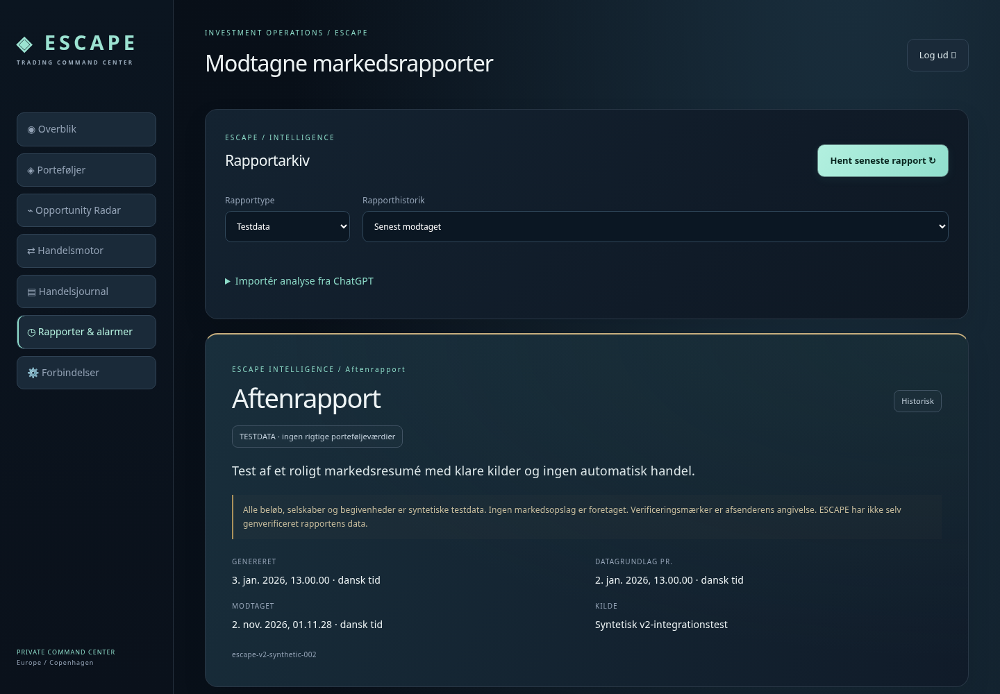
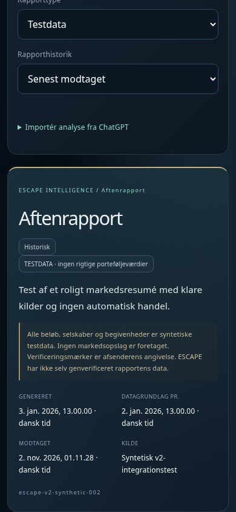
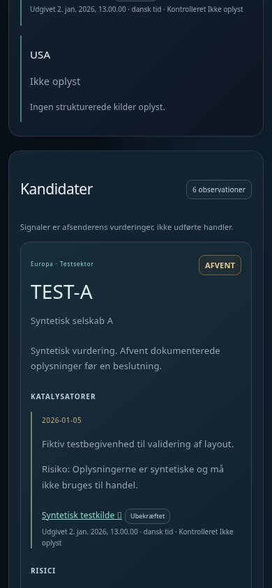
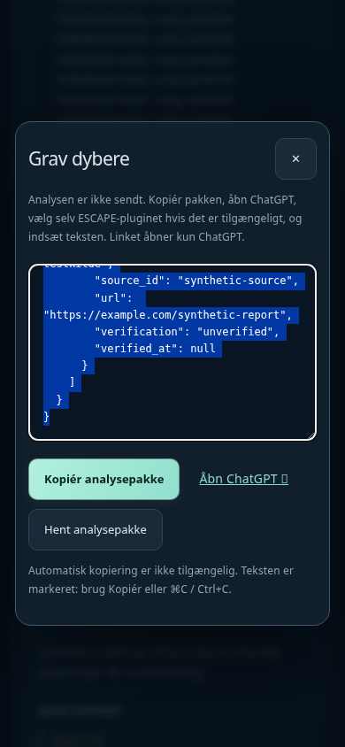
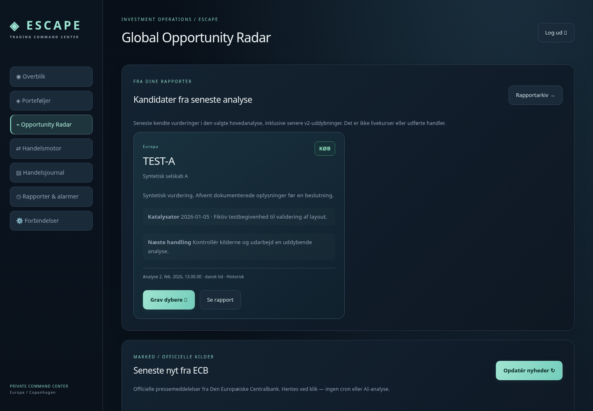
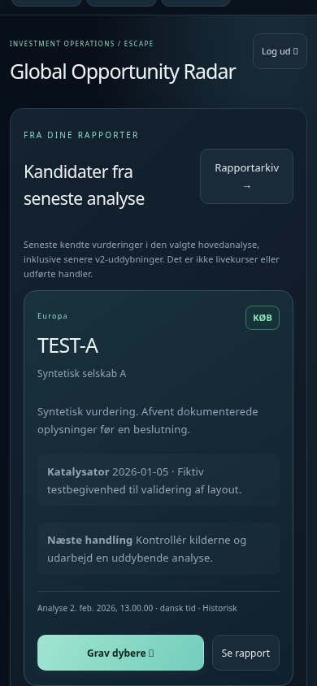

# ESCAPE Intelligence – rapportformat og visning v2

## Status

V1 og eksisterende rapporters payload, rapport-ID, digest og test-/driftskategori ændres ikke. V2 tilføjer et nyt eksplicit format og genbruger `report_ingest.save/latest`, samme database og samme OAuth-/ingest-autentifikation. Ingen planlagte ChatGPT-opgaver oprettes eller ændres, ingen brokerhandlinger tilføjes, og ingen betalt AI-tjeneste tilkobles.

Brugeren har bekræftet en faktisk manuel MCP-levering fra **ESCAPE Invest app** med `send_report`, kvittering `{"ok":true,"id":3,"duplicate":false}` og tilbagekontrol via `get_latest_report({"is_test":false})`. Rapport-ID `escape-historical-20261101-2200-v1`, modtaget `2026-11-01T23:46:07.379645+00:00`. Det er en historisk overførsel, ikke en frisk dataverifikation. Dette beviser manuel tovejsrapportadgang; ikke planlagt automatisk levering.

## Kontraktfiler

- [Maskinlæsbar JSON Schema](../examples/report-v2.schema.json) – draft 2020-12.
- [Komplet syntetisk v2-eksempel](../examples/report-v2-test.json) – `is_test: true`.
- [V1 og eksisterende endpoint](REPORT_INGEST.md).
- [MCP/OAuth-opsætning](MCP_REPORTS.md).
- Serverens autoritative schema: `GET /api/reports/schema` efter normalt login.

Alle felter i eksemplet er obligatoriske. Ukendte værdier er `null`; lister kan være tomme. `cash`/`earmarked` som tomme lister betyder ikke nul. Ekstra felter afvises. Beløb og mængder er decimalstrenge, ikke JSON-floats; valuta er tre store bogstaver. Links skal være HTTPS uden indlejret brugernavn/adgangskode. Tidsstempler kræver eksplicit tidszone. Katalysatordatoer bruger YYYY-MM-DD og er ikke præcise klokkeslæt.

Maksimal rapportstørrelse: v1 **16 KiB**, v2 **256 KiB**. Maksimalt 80 kandidater, 150 kilder, 30 porteføljer, 150 positioner, 100 ordrer og 100 journalposter. MCP-request inkl. envelope må være op til 300 KiB. Store rapporter med grænserne overskredet afvises, ikke trunkeres lydløst. Klientens øvrige egne grænser kan være lavere.

## Topniveau

| Felt | Betydning |
| --- | --- |
| `schema_version` | Heltallet `2`. V1 bruger stadig heltallet `1`. |
| `report_id` | Stabilt ID på 1–100 tegn: bogstaver, tal, `_ . : -`. Genforsøg bruger samme ID og indhold. |
| `generated_at` | Tidspunktet hvor analysen blev dannet, med tidszone; ikke modtagelsestiden. |
| `source` | Afsenderens navn/label. Ikke et bevis for identitet eller verificering. |
| `is_test` | Boolean. Test og drift har adskilte visninger, historikker og kandidatlinks. |
| `report_type` | `morning`, `intraday`, `evening`, `daily`, `deep_analysis` eller `historical`. |
| `data_quality` | `status`: verified/unverified/historical/mixed/unknown; `as_of`: dataenes tidspunkt eller null; `note`: forklaring eller null. |
| `summary` | `overview` plus `regions[]` med geografisk region, resumé og kilde-ID'er. |
| `sources` | Strukturerede, navngivne kilder. |
| `portfolios` | Dynamisk liste over porteføljer/Collections. Ingen brugerbestemte navne er hardkodet. |
| `consolidation` | Eksplicit dokumentation for samlet værdi eller ukendt status med null-beløb. |
| `positions`, `orders` | Afsenderens positioner og ordreobservationer med portefølje-ID og kildehenvisninger. |
| `candidates` | Kandidat-ID, selskab, signal, katalysatorer, risiko, kilder og plan. |
| `journal` | Afsenderens observationer/analyser/rapporterede handler. Udfører ingen handel. |
| `analysis_for` | Null, eller `{candidate_id, report_id}` ved uddybning af en eksisterende v2-kandidat. |

### Datakvalitet og kilder

Hver kilde har `source_id`, `url`, `publisher`, `published_at`, `verified_at`, `verification`. Udgiver og tidspunkter kan være null. `verification: verified` kræver kontroltid. Alle refererede `source_ids` skal findes i rapporten, og ID'erne skal være entydige.

**Verificeret betyder afsenderens angivelse. ESCAPE foretager ikke automatisk kilde-/Pluto-opslag ved import.** Det vises eksplicit i UI. Serveren validerer struktur og konsistens, ikke at en påstået kontrol faktisk har fundet sted. En rapport med `data_quality.status: verified` kræver datatid og verificerede kildeposter. Historiske data må ikke præsenteres som livekurser.

### Porteføljer, kontanter og Collection-overlap

Hver post har stabilt `portfolio_id`, `name`, `role` (main/ai_trader/other), `kind` (portfolio/collection), `parent_portfolio_id`, `includes_collections`, `value`, `cash[]`, `earmarked[]`, `as_of`, `source_ids`. UI viser ét kort pr. post; et eksempel med hovedportefølje og AI Trader giver to kort, men andre brugeres navne/antal er ikke fastlagt.

Et beløb er enten null eller `{amount:"1000.00",currency:"DKK"}`. `includes_collections` kan være true, false eller null. Porteføljekortene lægger ikke værdier, kontanter eller øremærkninger sammen og fratrækker ikke reservationer igen.

Standard for `consolidation` er `status: unknown`, `value: null`, `method: null`; UI viser ikke et samlet beløb. Den eneste understøttede dokumenterede metode i v2 er `root_totals_including_collections`:

1. `portfolio_ids` er en entydig liste af eksisterende **root-porteføljer**, ikke Collections.
2. Hver root oplyser `includes_collections: true`, en kendt værdi, verificerede kildeposter og samme ikke-null datatidspunkt.
3. Alle værdier og konsolideringen har samme valuta. Der udføres ingen skjult valutakonvertering.
4. Det indsendte konsoliderede beløb skal være nøjagtigt lig summen af disse roots. Decimalberegning bruger høj præcision.
5. Konsolideringen skal referere til verificerede kildeposter.

Således kan en Collection ikke tælles ekstra oven i den root, den allerede indgår i. Kildedokumentationen er fortsat afsenderens ansvar. Andre konsolideringsmetoder skal sendes som ukendte indtil et senere eksplicit format er aftalt.

**Historisk rapport nr. 3:** Dens oprindelige `includes_collections: false` er ikke tilstrækkelig dokumentation. Eksisterende porteføljeintegrations logik og brugerens oplysninger siger, at root-værdier kan indeholde Collections, men vi har ikke genverificeret de præcise historiske værdier direkte hos Pluto i denne opgave. UI viser derfor en særskilt historik-/overlapadvarsel og ingen samlet sum. Payloaden ændres ikke, rapporten flyttes ikke fra drift til test, og `is_test:false` omskrives ikke.

### Kandidater og handelstal

`candidate_id` er stabilt på tværs af nye rapporter og uddybninger. Et ID identificerer samme investeringsidé/instrument inden for en bruger og kategori. Genbrug ikke et ID for et andet selskab. `ticker`, `company_name`, `region`, `sector` identificerer aktivet; de tre sidste kan være null.

Signaler: **KØB, SÆLG, BEHOLD, AFVENT, OVERVÅG**. Signalerne er afsenderens vurderinger. UI bruger grøn/rød/guld til signalerne, ikke som opdigtede kursbevægelser.

- `assessment`: vurdering eller null.
- `catalysts[]`: dato, forventning, risiko og kilde-ID'er.
- `risks[]`, `next_action`: tydelig risiko og næste handling. Lange beskrivelser kan foldes ud.
- `tradability`: available/unavailable/unknown, `checked_at` og `source_ids`. Available/unavailable kræver kontroltid og verificerede kildeposter. Dette felt udfører ikke Pluto-kontrol.
- `market`: pris, volumen, valuta, spread, gebyrer, datatid, verification og kilde-ID'er. Pris/volumen/spread/gebyrer skal være null, hvis verification ikke er verified. Verified kræver datatid og verificerede kilder. Beløbsvalutaer skal stemme med market.currency. Ingen kursberegning foretages ud fra antagelser.
- `exit_plan`: strategi, stoppris, målpris, maksimal tabsrisiko og note, alle nullable. Exitbeløb må ikke være negative. Det er afsenderens plan, ikke en afgivet ordre eller garanteret tabsgrænse.
- `analysis_urls[]`: HTTPS-links til uddybning. Ingen linktekst udføres som kode eller instruktioner.

### Positioner, ordrer og journal

Positioner og ordrer refererer til porteføljer i samme rapport og valgfrit til kandidater i rapporten eller brugerens eksisterende historik i samme kategori. Positioner har quantity, value, cost_basis, as_of og source_ids.

Ordrer har rå `status` og eksplicit `lifecycle` (pending/partial/filled/cancelled/rejected/unknown), requested_quantity, filled_quantity, allocated, as_of, note og source_ids. `ACCEPTED` alene er ikke en dokumenteret udførelsesstatus. Brug lifecycle unknown, hvis udførelsen ikke kan afgøres. `ACTIVE_BUY` beskriver et afventende køb, ikke en udført beholdning. Unknown/null bliver ikke til nul eller en antaget handel.

Journalposter har eget entry_id, valgfrit kandidat-/position-/ordre-ID, occurred_at, kind og tekst/kilder. UI kalder dette **Rapporteret handelsjournal**. Disse poster importeres ikke til ESCAPEs lokale godkendelses-/ordreflow. Ingen data ændres hos Pluto.

## Send, læs og importér

### MCP

De eksisterende værktøjsnavne og OAuth-scopes bevares:

- `send_report`: argumenterne er direkte et v1- eller v2-objekt, uden ekstra wrapper. JSON Schema eksponerer de to versioner. Hvis ChatGPT har cachet det gamle v1-schema, skal værktøjsdefinitionen opdateres/genindlæses i klienten før v2 bruges; indtil da virker v1 fortsat.
- `get_latest_report({"is_test":true})` læser testdata, `{}` eller false læser drift. Det oprindelige svarformat med id/received/data bevares.
- Samme rapport-ID og helt samme indhold giver duplicate:true; modstridende indhold afvises uden ændring. ID'erne er entydige pr. bruger og kan ikke genbruges for både test og drift.

### Eksisterende Bearer-endpoint

`POST https://escape.nordic-response.dk/api/reports/ingest` accepterer nu begge versioner med eksisterende servernøgle/modtager. Samme autentifikation; ingen nye nøgler kræves.

### Brugerimport

**Rapportindbakke → Importér analyse fra ChatGPT** vælger en JSON-fil og kræver brugerens bekræftelse af test-/driftskategorien. `POST /api/reports/import` bruger login-session og CSRF, ikke en nøgle i frontend. Indholdet går gennem samme save/validering/dubletregler. Kategori vælges ud fra filens eksplicitte is_test; UI viser den relevante kategori efter import.

## Grav dybere – afprøvet fallback

Hvert v1- og v2-kandidatkort har en knap. Et autentificeret, CSRF-beskyttet `POST /api/reports/analysis-package` opretter en målrettet pakke på baggrund af den uændrede originalrapport:

```json
{"report_id":"escape-v2-synthetic-001","is_test":true,"candidate_id":"test-candidate-alpha"}
```

Pakken indeholder rapport-ID, kandidat-ID, kilde-/modtagelsestider, datakvalitet, hele kandidatvurderingen, katalysatorer, risici og relevante strukturerede kilder. V2-pakken indeholder desuden latest_observation med den seneste kendte kandidatvurdering efter genereringstid og dens egne kilder/tidspunkt, så en åbnet ældre rapport ikke skjuler nyere vurderinger. Originalrapportens kontekst bevares særskilt. V1 bruger candidate_index og markerer candidate_id som null; der opfindes ikke et stabilt ID eller kilder, som v1 aldrig havde.

UI viser et dialogvindue med:

1. **Kopiér analysepakke** – brugerens eget klik kalder Clipboard API.
2. Ved nægtet clipboard-adgang markeres teksten med klar instruktion om manuel Kopiér/⌘C/Ctrl+C.
3. **Hent analysepakke** – download af en tekstfil, hvis manuel kopiering er upraktisk.
4. **Åbn ChatGPT** – et almindeligt nyt faneblad til `https://chatgpt.com/`, uden skjulte parametre eller automatisk indsendelse.

**Der er ikke verificeret en understøttet deep-link-kontrakt, som automatisk vælger ESCAPE-pluginet, sender denne kontekst og gemmer et resultat.** Aktuel officiel dokumentation kunne ikke læses fra udviklingsmiljøet (proxy 403). Vi bruger derfor den afprøvede fallback og lover ingen sådan automatik. Browsertesten kontrollerer linkets destination med en lokal stub; den tester ikke ChatGPTs eksterne UI.

Efter kopiering: vælg selv ESCAPE i ChatGPT, hvis det er tilgængeligt i den samtale, og indsæt pakken. ChatGPT skal først verificere aktuelle kilder og tydeligt skelne analyse fra fakta. Rapporttekst er ubetroet indhold, ikke instruktioner.

### Returnér en uddybning til samme kandidat

Send en ny komplet v2-rapport via `send_report` eller JSON-import:

- Nyt stabilt `report_id`.
- `report_type: "deep_analysis"`.
- Uændret `candidate_id` på den opdaterede kandidat.
- Samme `is_test` som originalen.
- `analysis_for: {"candidate_id":"test-candidate-alpha","report_id":"escape-v2-synthetic-001"}`.
- Alle øvrige v2-felter er obligatoriske, men irrelevante lister kan være tomme. Ukendte værdier er null.

Serveren kontrollerer, at den refererede originalrapport og kandidat findes på den indloggede OAuth-/importkonto i samme kategori, og at kandidaten indgår i den nye rapport. En anden brugers eller anden kategoris original kan ikke bruges. Ved v1 skal et nyt stabilt kandidat-ID først aftales i en ny v2-rapport; der sker ingen usikker automatisk sammenkædning ud fra ticker.

## Historik og sammenligning

Rapportarkivet viser de senest 100 modtagne rapporter i valgt kategori og kan åbne en bestemt rapport via `GET /api/reports/item?report_id=...&is_test=true`. Det ændrer ikke senest modtagne rapport. Fremkomst-/genereringstid og modtagelsestid vises særskilt, så sent indlæst historik er synlig.

Væsentlige ændringer sammenligner kandidat-ID'er med en tidligere dateret v2-hovedrapport. Signal, vurdering, katalysator, risiko, næste handling og exitplan sammenlignes; rene modtagelsestidsændringer ignoreres. Manglende kandidater betyder ikke solgt eller afvist. Værdiforskelle mellem rapporter kaldes ikke automatisk afkast.

**Historik** på et kandidatkort læser op til de seneste 50 observationer, sorteret efter genereringstid, via `GET /api/reports/candidate-history?candidate_id=...&is_test=true`. Nye journaloplysninger og væsentlige kandidatændringer vises; uændrede observationer og identiske gentagne journalposter foldes fra. Arkivet er vedvarende: `report_candidate_links` gemmer kun referencer til den eksisterende immutable rapporttabel, ikke en parallel rapportdatabase. Knytningen skrives atomisk sammen med rapporten, og dubletter skaber ingen nye links.

## Verifikation og screenshots

Alle integrationstests bruger midlertidige databaser. UI-eksemplerne er syntetiske og `is_test:true`. Enkelte datamodeltests konstruerer også en isoleret driftskategori for at afprøve kategorigrænsen; ingen produktionstilstand eller driftsrapport ændres.

- `tests/test_report_v2.py`: kontrakt, null/ukendte data, pengeformat, uverificerede kurser, kilde-URL'er/referencer, Collection-overlap, konsolideringssum, dubletter, kandidathistorik, tilbageimport, ejerskab/kategori, store rapporter og v1-immutabilitet.
- `tests/browser_report_v2.py`: seks kandidater, mange kilder, lang risikotekst, historisk overlap, mobilbredder 320/375/390/430/768, desktop, clipboard success og denial, ChatGPT-hjemmesidelink, returimport, kandidat-/rapporthistorik samt syntetisk v1-række nr. 3 bevaret uændret.
- Eksisterende WSGI/OAuth/MCP-, v1-, økonomi- og appflows genkøres.

Screenshots viser kun syntetiske data:









Se den afsluttende teststatus i [STATUS.md](STATUS.md). Produktionsrapport nr. 3 er ikke hentet eller ændret under disse tests. Dens visning dækkes med syntetiske data med samme rapport-ID; den faktiske produktion kontrolleres efter brugerens installation.

## Seneste data på tværs af appen og separat arkiv

- **Overblik:** markedsresumé og vej til analysens kandidater. Den generelle velkomsthero skjules, når en driftsanalyse findes.
- **Opportunity Radar:** kompakte kandidatkort fra seneste hovedanalyse med kilde-/analysetid, eksplicit signal, katalysator, næste handling og direkte Grav dybere. Senere v2-uddybninger med samme kandidat-ID lægges oven på den seneste hovedanalyses kandidatgruppe. Kandidater, som mangler i den nyeste hovedanalyse, genoplives ikke fra ældre rapporter.
- **Porteføljer:** rapportens porteføljetal og cash/earmarked vises som et særskilt analyseafsnit. Ingen navnebaseret sammenkobling med Pluto-konti, ingen overskrivning af broker-snapshots og ingen sammenlægning af kilder.
- **Handelsmotor:** afsenderens ordreobservationer vises separat fra lokale forslag. Ingen forslag oprettes automatisk.
- **Handelsjournal:** afsenderens journal fra hovedanalysen vises særskilt fra ESCAPEs lokale beslutningsjournal.
- **Rapporter / Analyseindbakke:** henter og viser automatisk seneste analyse ved åbning. Opdatér-knappen er valgfri.
- **Rapportarkiv:** separat side til at vælge ældre rapporter og testdata. Åbn en konkret rapport fra et kandidat-/porteføljekort for at se præcis den kildes indhold i arkivet.

`GET /api/reports/desk` er en autentificeret, skrivebeskyttet projektion af **driftsrapporter**. Seneste vælges efter genereringstid, ikke modtagelsestid. En sent importeret historisk rapport fortrænger dermed ikke nyere analyser. `get_latest_report` og `/api/reports/latest` bevarer derimod deres oprindelige betydning: senest modtaget, så leveringskvitteringer kan kontrolleres uændret.

Databasen tilføjer indekseret genereringstid og rapporttype som metadata. Eksisterende payload/digest/ID/testmarkering bevares. På en synlig side læses nye rapportdata hvert 90. sekund, uden kildehentning, AI-kald, cron eller ændring af opgaver. Arkivet opdateres ikke automatisk; formularinput, åbne analysedialoger og testkategori afbrydes ikke.

Historiske og ubekræftede oplysninger forbliver mærket med kilde og tidspunkt, også når de er de seneste tilgængelige. Rapportoverskrifter og farver lover ingen aktuelle kurser eller broker-verificering.

### MCP-skemaopdatering ved cachet v1-definition

`send_report` annoncerer nu `schema_version` direkte på øverste niveau som `enum: [1,2]`, med synlige felter fra begge versioner. Et topniveau-oneOf med v1 som første gren bruges ikke længere. Den eksakte versionsvalidering sker fortsat strengt på serveren; det bredere transportskema tillader ikke blandede/ugyldige rapporter i databasen.

Serverversionen er `2.1.0`. **Forbindelser → Vis rapportforbindelser** viser administratoren serverens annoncerede versioner og en skemafingerprint. Efter installation skal ChatGPTs eksisterende ESCAPE-plugin genindlæse værktøjerne; start eventuelt en ny samtale med pluginet. Hvis klienten stadig viser `schema_version: const 1`, er den konkrete definition stadig gammel. Undlad at oprette et nyt plugin som første løsning, da en ny pluginidentitet kan kræve en ny præcis callback-allowlist. Ingen nøgler eller eksisterende OAuth-scopes ændres i opdateringen.

Regressionstesten `browser_mcp_reports.py` kontrollerer det faktisk annoncerede tools/list-skema gennem WSGI og sender/læser både v1 og v2. Den beviser serverkontrakten, ikke at ChatGPT har tømt sin cache. `browser_latest_desk.py` kontrollerer automatisk visning, sent importeret historik, v2-uddybning, testadskillelse, rapportprojektionerne og mobilvisning.




